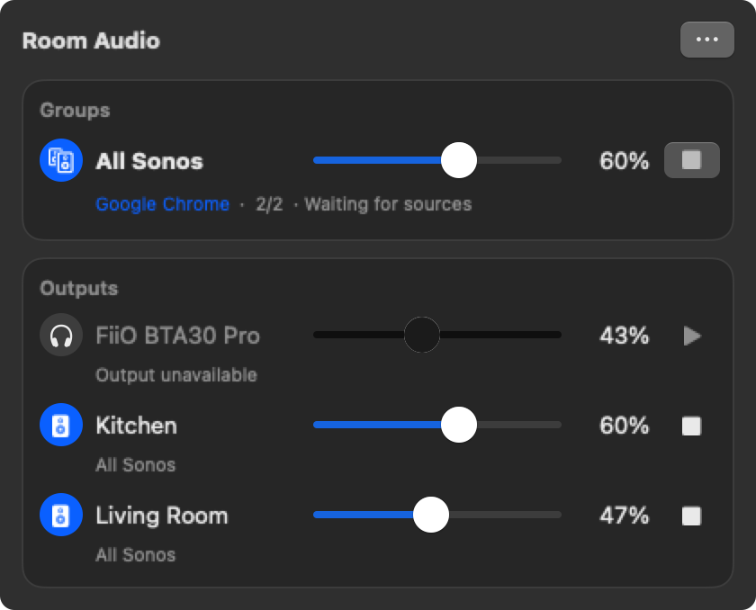

# Room Audio

Route audio from Mac apps and audio inputs to AirPlay speakers and Bluetooth devices. Send Chrome to the kitchen and a different app to the living room, or play the same mix across both rooms.



*Menu bar panel with example devices.*

## Features

- **Choose what each room hears.** Route a running app or a Core Audio input to an individual output. Virtual inputs such as BlackHole are optional.
- **Save synchronized AirPlay groups.** Choose one or more receivers, mix multiple sources, and adjust each source’s level or mute it while streaming.
- **Keep the speaker balance.** The group slider shows the loudest controlled output. Moving it scales the other levels proportionally, including when you turn the group down to zero and back up.
- **Control playback from the menu bar.** Start, stop, and adjust outputs from the compact panel. Closing the main window keeps active streams running.
- **Reconnect after interruptions.** Room Audio retries interrupted AirPlay routes and resumes active groups after the Mac wakes. Sources that return with the same app or audio device identity can rejoin an active mix.

## Build from source

Requires an Apple silicon Mac running macOS 15 or later and the Xcode Command Line Tools.

```bash
git clone https://github.com/karlovnv/Room-Audio.git
cd Room-Audio
sh build.sh
open "Room Audio.app"
```

The build downloads the pinned ARM64 version of `cliairplay`, verifies its SHA-256 checksum, and builds and signs `Room Audio.app` in the repository. To build with an existing copy of the same transport binary, set `ROOM_AUDIO_TRANSPORT` to its absolute path.

The script uses the **Room Audio Local Signing** identity if available and falls back to ad hoc signing. Set `ROOM_AUDIO_SIGNING_IDENTITY` to use a specific identity. Reusing the same signing identity helps macOS recognize the app across rebuilds.

## Get started

1. Allow local network access if macOS asks. For AirPlay, open the main window and choose **Set Up AirPlay Sync…** in the full view to install the synchronization service. macOS asks for administrator approval during setup.
2. Choose a **Source** in an output row and click **Start**. macOS may ask for system audio recording or microphone access, depending on the source.
3. To create a saved group, open **… → New Group…** in the main window, give it a name, and select its AirPlay outputs. Click the source summary to open its mixer inside the compact panel or from the main window. The checkboxes apply immediately, including when you clear the last source. An active group stays connected and sends silence until a source provides audio.
4. Use **… → Output Visibility** to pin outputs in the menu bar panel. The **Simple Mode** setting changes the layout of the main window.

Use **Also Play on This Mac** to keep an app audible locally. In a group mixer, this action is in the source row’s context menu.

Connect Bluetooth outputs in macOS Bluetooth settings first. In the main window, choose **… → New Bluetooth Group…**, select one source, and choose the Bluetooth outputs. Expand the group in the main window to set each device’s volume, stereo balance, and additional delay (0–1000 ms). macOS and each device negotiate their Bluetooth codec.

## How routing works

An AirPlay output can belong to several saved groups and play one route at a time. When an active group is waiting for an output, it can pick up that output as soon as it becomes free. **Take Over** moves the output to the selected group. **Connect** restores an output you stopped manually within a group.

Room Audio checks whether a Sonos output is already in use. If a TV input is active, the lightning button (**Force Play**) lets you switch that output to Room Audio. Other receivers in the group can continue playing.

## Current limits

- App capture works at the app level. A browser source includes its audio across tabs.
- AirPlay groups synchronize their receivers. Bluetooth groups use independent device streams and manual delay adjustment. Bluetooth and AirPlay outputs are grouped separately. Screen mirroring synchronization is outside the current scope.
- Chromecast output, manual AirPlay delay adjustment, and polarity inversion are outside the current scope.

## Credits

Room Audio uses `cliairplay` from Music Assistant for AirPlay transport. See the [pinned v0.5.17 release](https://github.com/music-assistant/airplay-cli/releases/tag/v0.5.17) and the [transport’s GPL-3.0 license](https://github.com/music-assistant/airplay-cli/blob/v0.5.17/LICENSE).
